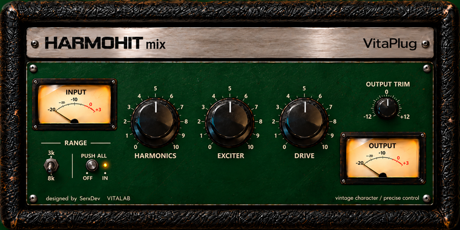
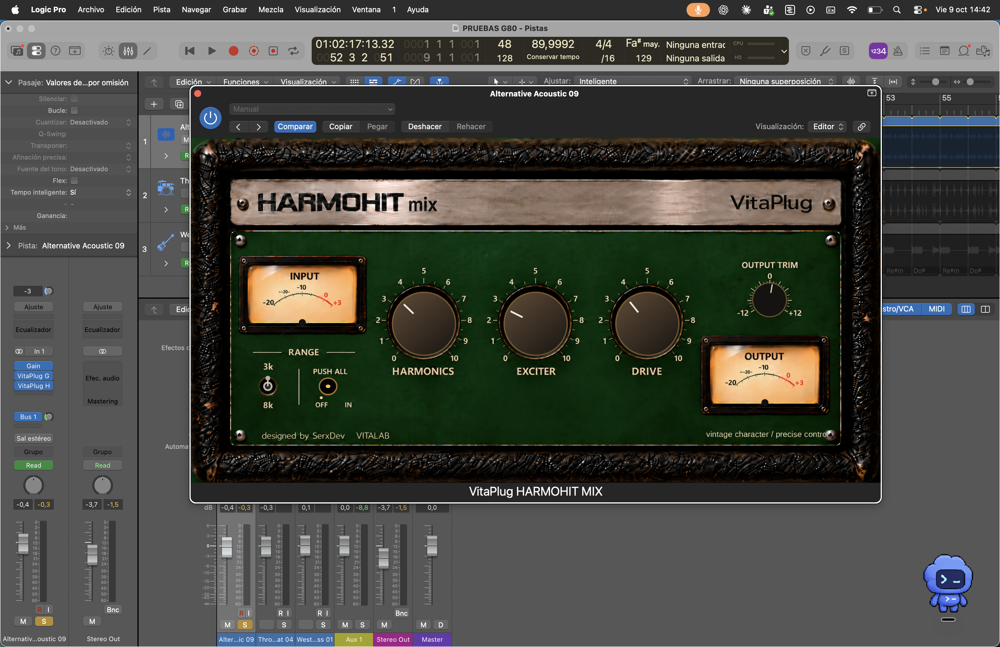

# VitaPlug HARMOHIT

**VitaPlug Creative Bundle · Vitalab**
*vintage character / precise control*

HARMOHIT is an in-progress C++/JUCE audio-effects project comprising two AU/VST3 processors that share a header-only DSP core:

- **VitaPlug HARMOHIT MIX** — a broader, creative coloration variant.
- **VitaPlug HARMOHIT MASTER** — a more restrained variant intended for smaller adjustments.

The project explores spectral shaping, aural excitation and analog-inspired drive. It is published as a technical portfolio and learning record; see [Reuse and licensing](#reuse-and-licensing) before using any source or assets.

## Final UI design

The following 760×380 image is the approved final visual design for HARMOHIT MIX. It establishes the vintage Vitalab presentation, control layout and visual identity for the final UI.



## Current implementation

The current source of truth is commit `34a1909` and the code in this repository.

| Area | Implemented today |
| --- | --- |
| Plug-in formats | AU and VST3 on macOS; VST3 on Windows, as configured by CMake |
| Audio layouts | Mono and stereo |
| DSP | 4× oversampled shared core, 20 ms parameter smoothing, finite-sample containment and reported host latency |
| Controls | HARMONICS, EXCITER, range (3 kHz / 8 kHz), PUSH ALL, DRIVE, Output Trim and Bypass |
| State | APVTS parameter serialization, including migration from the earlier three-state EXCITER mode |
| Metering | Input and post-Trim output VU taps with a 300 ms power integration |
| Editor | A functional 520×300 engineering editor with direct parameter attachments |

The approved final UI design above, the vintage panel artwork under `Resources/HARMOHIT/`, and the large visual-check images describe the project’s visual direction. They are distinct from the current runtime editor drawn by `Source/PluginEditor.cpp`; the current compiled editor is the engineering interface described above. This distinction keeps the repository technically accurate while preserving the final UI design as the visual reference.

## Logic Pro smoke capture

The following is an authentic HARMOHIT MIX smoke capture from Logic Pro, recorded on 9 October 2026. It is retained as evidence of an in-host test and is distinct from the design-reference artwork.



The capture documents the tested MIX presentation at that point in development; the checked-in source and implementation-status notes above remain the authoritative description of the current code.

## Signal path

```text
input → 4× oversampling → HARMONICS → EXCITER + DRIVE → Output Trim → downsampling
```

`EXCITER` and `DRIVE` add nonlinear residuals to the current signal. `HARMONICS` is variant-specific: MASTER retains its earlier nonlinear residual algorithm, while MIX uses the spectral macro described below. There is no final limiter, mandatory normalization or automatic output compensation; Output Trim remains manual. The oversampling route is retained during bypass so host latency alignment is preserved.

## HARMONICS in HARMOHIT MIX

The parameter name **HARMONICS** has been retained for continuity, but it must not be described as a nonlinear harmonic generator in the current MIX implementation.

Early development used nonlinear harmonic generation. Listening and smoke tests showed that its predominant result was distortion that was not useful for this product, so the MIX macro was rebuilt as three linear shelving stages:

| Stage | Nominal transition | Maximum at macro = 100% |
| --- | ---: | ---: |
| Body low shelf | 300 Hz | +6 dB |
| Presence high shelf | 1.8 kHz | +7 dB |
| Air high shelf | 12 kHz | +9 dB |

These R5 maxima are present in `calibrateMixHarmonics()` in `Source/DSP/HarmoCore.h`. The macro uses independent concave gain laws, so the intermediate position is deliberately not a simple linear fraction of each maximum.

The shelves are cascaded. At a frequency where both high shelves contribute, their gains multiply in linear gain (and therefore add in dB); the +7 dB and +9 dB figures are individual stage maxima, not a single capped “treble” boost. The response also contains the low shelf, so the final frequency response is the product of all applicable stages. No saturation, DC blocking, dry/wet cancellation or output normalization is added by the MIX HARMONICS macro itself.

## Build

Requirements:

- CMake 3.22 or later
- A C++20 compiler
- A local **JUCE 9.0.3** source checkout

JUCE is deliberately not vendored. Point CMake at it with `JUCE_DIR`; the default is a developer-local sibling path and will not normally exist after a fresh clone.

```sh
cmake -S . -B build -G "Unix Makefiles" \
  -DCMAKE_BUILD_TYPE=Release \
  -DJUCE_DIR=/absolute/path/to/JUCE
cmake --build build --target VitaPlugHarmoHitDSPTests
ctest --test-dir build --output-on-failure
```

Build plug-in targets when the platform toolchain and JUCE configuration are available:

```sh
cmake --build build --target \
  VitaPlugHarmoHitMix_AU VitaPlugHarmoHitMix_VST3 \
  VitaPlugHarmoHitMaster_AU VitaPlugHarmoHitMaster_VST3
```

On Windows, CMake configures VST3 only. The `VitaPlugHarmoHitMixEditorPreview` target is a development-only JUCE application for inspecting the real MIX editor; it is not an installer or plug-in format.

## Verification

`VitaPlugHarmoHitDSPTests` covers, among other things:

- 4× oversampling and latency coherence;
- neutral and bypass alignment;
- R5 HARMONICS response, monotonic progression, linearity and sample-rate checks;
- mono/stereo, block-size and finite-value safety;
- automation, parameter serialization and legacy-state migration;
- EXCITER range/PUSH ALL routing and VU tap placement.

The detailed engineering record, including known limits and the development decisions behind the current DSP, is in [Documentation/DEVELOPMENT_NOTES.md](Documentation/DEVELOPMENT_NOTES.md). Third-party and repository-publication notes are in [Documentation/THIRD_PARTY_AND_PUBLICATION.md](Documentation/THIRD_PARTY_AND_PUBLICATION.md).

## Reuse and licensing

No license for reuse of VitaPlug HARMOHIT source code or artwork is currently offered. This public repository does not grant general permission to reuse, modify or redistribute the project’s own code or assets.

JUCE and any other third-party material remain subject to their own licenses. A person building, distributing or otherwise using a derivative must independently ensure that their JUCE licensing and all other obligations are satisfied; see [Documentation/THIRD_PARTY_AND_PUBLICATION.md](Documentation/THIRD_PARTY_AND_PUBLICATION.md).
